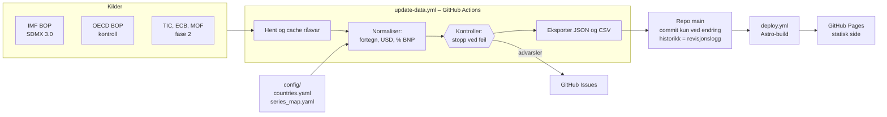

# Global Capital Flows – designdokument

22.11.2026 · Kilde: [designdokumentet i Claude](https://claude.ai/artifact/BiWK8qayVkJHYz8atRvfAX). Denne fila er fasit i repoet. Endringer i design gjøres her, via PR.

## Sammendrag

Vi bygger en åpen, statisk nettside som viser **netto kapitalstrømmer inn og ut av de ~20 største økonomiene**, basert kun på offisiell betalingsbalansestatistikk (BPM6) fra gratis offentlige kilder. Alt bygges, oppdateres og publiseres i ett GitHub-repo: GitHub Actions henter data etter en tidsplan, git-historikken sporer revisjoner, og GitHub Pages serverer siden. Det er ingen server, database eller betalt tjeneste.

De viktigste designbeslutningene:

- **Ett felles språk:** IMF BOP (BPM6) er ryggraden. Andre kilder brukes til kontroll, utfylling og separate moduler, aldri blandet inn i hovedrangeringen.
- **Brukervennlig fortegn:** positivt tall = netto *innstrømning*. Det er motsatt av BPM6, og konverteringen skjer på ett sted i koden.
- **Standardvisning:** siste fire kvartaler, ekskludert valutareserver, med valg mellom USD og % av BNP.
- **Strømmer, ikke beholdninger:** endringer i beholdninger brukes aldri som erstatning for strømmer.
- **Ærlighet foran effekt:** periode, kilde, publiseringsdato og revisjonsstatus vises alltid. Manglende data vises som «ikke rapportert», aldri som null.
- **Første utviklingssteg er en dekningsmatrise.** Den viser hvilke land og serier som faktisk finnes, før noe UI bygges.

## Mål og ikke-mål

**Mål**

1. Vise hvilke store økonomier som er netto kapitalimportører og -eksportører, og hvordan det endrer seg over tid.
2. Forklare hva som ligger bak nettoen: direkteinvesteringer, portefølje, annen investering, derivater og reserver, samt utlendingers kjøp her mot innenlandske aktørers kjøp ute.
3. Gjøre land sammenlignbare med felles valuta (USD), felles periode og % av BNP.
4. Være etterprøvbar: hver verdi kan spores til kildeserie, nedlastingstidspunkt og versjon i git.
5. Kjøre helt gratis på GitHub (Actions + Pages) og være vedlikeholdsfri i hverdagen.

**Ikke-mål (første versjoner)**

- Sanntidsdata eller fondsstrømmer fra betalte trackere (EPFR, IIF o.l.).
- En fullstendig land-til-land-matrise for alle kapitaltyper. Den finnes ikke i offentlige data.
- Animerte piler mellom land basert på nettotall mot resten av verden.
- Automatiske overskrifter som «kapitalflukt».
- Prognoser eller egne estimater.

## Begreper og måltall

Hovedmålet er **netto finansregnskap** fra betalingsbalansen (BPM6), vist med snudd fortegn slik at positivt betyr netto innstrømning.

**Fortegn.** I BPM6 er netto finansregnskap = netto erverv av finansielle eiendeler − netto pådrag av forpliktelser. Positivt betyr netto utlån til utlandet, altså utstrømning. Siden viser:

```
NetInflow = ΔLiabilities − ΔAssets = −FA_net(BPM6)
```

Konverteringen gjøres i én funksjon i pipelinen (`to_inflow_sign()`), med enhetstester. Rådata lagres alltid med kildens originale fortegn.

**Komponenter (funksjonelle kategorier i BPM6)**

| Kode i datamodellen | Komponent | Merknad |
| --- | --- | --- |
| `fa_total` | Finansregnskapet totalt | Inkluderer reserver |
| `fa_ex_reserves` | Finansregnskap ekskl. reserver | **Standardvisning.** Kalles ikke «private strømmer», fordi offentlige aktører også inngår |
| `fdi` | Direkteinvesteringer | Blåses opp av gjennomstrømningsselskaper i finanssentre |
| `portfolio` | Porteføljeinvesteringer | Helst delt i aksjer og gjeld der data finnes |
| `other_inv` | Annen investering | Banklån, innskudd, handelskreditt |
| `derivatives` | Finansielle derivater | Ofte bare netto, mange land mangler |
| `reserves` | Reserveaktiva | Sentralbankens transaksjoner, egen kategori |

**Støtteserier**

- `current_account` (driftsbalansen): vises som kontroll. Den speiler omtrent finansregnskapet med motsatt fortegn.
- `capital_account` (kapitalkonto i snever forstand): brukes i speilingskontrollen.
- `errors_omissions` (feil og utelatelser): vises eksplisitt, særlig der den er stor.
- `gdp_usd` (BNP i USD): nevner for % av BNP.

**Netto mot brutto.** Hver komponent lagres som to sider der kilden har det: `assets` (innenlandske aktørers netto kjøp i utlandet) og `liabilities` (utlendingers netto kjøp i landet). Netto utstrømning kan skyldes at innenlandske investorer kjøper mer ute, ikke at utlendinger trekker seg ut. Det må landvisningen få frem.

**Strømmer mot beholdninger.** Strømmer er transaksjoner. Beholdninger (IIP, CPIS, BIS-posisjoner) endres også av kurs- og valutaeffekter. Beholdninger kan vises i egne moduler, merket tydelig, men endringer i beholdninger brukes **aldri** som erstatning for strømmer.

**% av BNP.** Firekvartals sum av strømmen delt på BNP for de samme fire kvartalene. BNP er årlig (IMF WEO `NGDPD`), så hvert kvartal får en fjerdedel av sitt års BNP. For enkeltkvartal blir dette kvartalsstrøm delt på årets BNP/4, altså annualisert. BNP for år etter referanseåret er WEO-anslag og merkes slik.

**Beregnet hovedmål.** Der IMF ikke publiserer `fa_ex_reserves` (`FABXRRI`), men har `FAB` og reserver `R_F`, beregnes `fa_ex_reserves = FAB − R_F`, merket `derived` og forklart på landsiden (gjelder Russland fra 2022).

## Datakilder

IMF BOP er primærkilden. OECD er kontroll og utfylling. Resten er separate moduler som aldri blandes inn i hovedrangeringen. Alle kildene er gratis, og IMF-API-et krever ingen innlogging.

| Kilde | Rolle | Frekvens | Tilgang | Viktig begrensning |
| --- | --- | --- | --- | --- |
| [IMF Balance of Payments (BOP)](https://data.imf.org/en/datasets/IMF.STA:BOP) | Primærkilde, alle komponenter | Kvartal, år | SDMX 3.0 REST, base `https://api.imf.org/external/sdmx/3.0` (også 2.1 under `/external/sdmx/2.1`). Dataflow `IMF.STA:BOP`, DSD `DSD_BOP` | Den gamle portalen `dataservices.imf.org` ble lagt ned 5. nov. 2025. Mange eksempler på nettet bruker den og fungerer ikke. Dekning og etterslep varierer per land |
| [OECD Balance of payments](https://db.nomics.world/OECD/DSD_BOP@DF_BOP) (`DSD_BOP@DF_BOP`) | Kontroll og utfylling, sammenlignbare kvartalsserier | Kvartal | SDMX REST via `sdmx.oecd.org/public/rest` | Ca. 51 land/aggregater. Ratebegrensninger: hent sjelden og mellomlagre |
| IMF WEO / NEA | BNP i USD (nevner) | År / kvartal | Samme IMF-API | Kvartals-BNP mangler for noen land. Da brukes årlig BNP, merket |
| [US Treasury TIC](https://home.treasury.gov/data/treasury-international-capital-tic-system) | Egen «nåkast»-fane for USA | Måned | CSV-nedlasting | Verdipapir- og bankstrømmer, ikke hele finansregnskapet |
| ECB Data Portal (`BPS`) | Månedlig betalingsbalanse for euroområdet | Måned | SDMX REST | Euroområdet som aggregat, summeres aldri med medlemslandene |
| Japans finansdepartement | Ukentlige porteføljestrømmer, Japan | Uke | CSV | Kun portefølje |
| [IMF Portfolio Investment Positions](https://data.imf.org/en/datasets/IMF.STA:PIP) og Direct Investment Positions | Senere bilateral fane: hvem eier hva hvor | Halvår / år | Samme IMF-API | **Beholdninger**, ikke strømmer |
| BIS Locational Banking Statistics | Senere: grensekryssende bankposisjoner | Kvartal | BIS Data Portal API | Posisjoner, ikke BOP-strømmer |
| [DBnomics](https://db.nomics.world/) | Kun utforskning og fallback | Varierer | Gratis API | IMF BOP-kopien der var sist oppdatert juni 2025. Hent IMF direkte |

**Bruksvilkår.** IMF tillater nedlasting, bearbeiding og videreformidling av statistiske data, men dataene må gjengis korrekt med kildeangivelse, f.eks. «Source: International Monetary Fund, Database Name, &lt;lenke&gt;». Ved mulig kommersiell gjenbruk ber IMF om at man skriver til copyright@imf.org først ([IMF Copyright and Usage](https://www.imf.org/en/about/copyright-and-terms)). IMF-logoen krever egen tillatelse og skal ikke brukes. OECD-data siteres som «OECD (år), (datasett), (kilde) DOI eller https://data-explorer.oecd.org/ (lest dato)».

**Åpent spørsmål:** blir siden kommersiell, for eksempel med annonser eller på en selskapsside? I så fall må IMF kontaktes før lansering.

## Landutvalg og perioder

**Utvalg.** De 20 største økonomiene etter nominelt BNP i USD (IMF WEO `NGDPD`) i **referanseåret = siste hele år med data**: året før siste felles kvartal, eller samme år hvis siste felles kvartal er K4. Utvalget låses i `data/processed/selection.json` og beregnes automatisk på nytt bare når referanseåret skifter. Endringer meldes som Issue. `config/countries.yaml` holder navn og flagg, ikke utvalget.

**Tillegg.** Norge som valgbart ekstraland, og euroområdet som eget aggregat. Euroområdet summeres aldri med medlemslandene.

**Land uten data.** Land som mangler data, vises i utvalget med merket «ikke rapportert». De fjernes ikke stille.

**Historikk.** Kvartalsdata fra 2010K1, der det finnes. Landsiden viser ti år som standard.

**Perioder i rangeringen**

- Standard er **siste felles kvartal**, det nyeste kvartalet der minst ~80 % av utvalget har data, og firekvartals sum frem til dette kvartalet.
- Alternativet «nyeste per land» viser perioden ved hvert land og merkes «mindre sammenlignbart».
- Årsvisning bruker kalenderår.

## Datamodell

Én lang (tidy) observasjonstabell pluss tre små oppslagstabeller. Lagres som Parquet for pipelinen og eksporteres til små JSON-filer for nettsiden.

**`observations`** (én rad per land × periode × mål × side)

| Felt | Type | Eksempel | Merknad |
| --- | --- | --- | --- |
| `country` | ISO3 | `USA`, `EA20` | Egen kode for aggregater |
| `period` | streng | `2026-Q2`, `2025` | |
| `freq` | enum | `Q`, `A`, `M` | |
| `measure` | enum | `fa_ex_reserves`, `fdi`, `portfolio`, `current_account`, `gdp_usd` | Se Begreper og måltall |
| `side` | enum | `net`, `assets`, `liabilities` | Brutto-sidene der kilden har dem |
| `value_raw` | tall | `-84.2` | Kildens fortegn og enhet, uendret |
| `value` | tall | `84.2` | Normalisert: mrd. USD, positivt = innstrømning |
| `unit` | streng | `USD_bn` | |
| `source` | enum | `IMF_BOP`, `OECD_BOP` | |
| `series_key` | streng | Full SDMX-nøkkel | For lenke tilbake til kilden |
| `obs_status` | enum | `final`, `preliminary`, `estimated`, `missing` | Fra kildens attributter |
| `published_at` | dato | | Når kilden publiserte verdien, hvis oppgitt |
| `retrieved_at` | tidsstempel | | Når pipelinen hentet den |

**`countries`**: ISO3, navn (nb/en), region, flagg for aggregat og finanssenter, IMF- og OECD-koder.

**`series_map`**: våre `measure` + `side` mot kildens SDMX-nøkkel per kilde. Dette er det eneste stedet kildekoder finnes. Filen er versjonert og gjennomgått.

**`coverage`**: per land og mål første og siste periode, antall hull og kilde. Genereres automatisk og driver både dekningsmatrisen og «ikke rapportert»-merkingen.

**Regler**

- Manglende verdi er `null` med `obs_status = missing`, aldri `0`.
- `value_raw` beholdes alltid, så normaliseringen kan etterprøves.
- Pipelinen skriver aldri over historikk utenfor git. Revisjoner sees som diff mellom commits.

**Filer til nettsiden** (`site/public/data/`)

- `meta.json`: siste oppdatering, siste felles kvartal og kildeliste.
- `ranking.json`: ferdigberegnet rangering for alle valg (kvartal, fire kvartaler, år, nyeste per land; USD og % av BNP).
- `country/<ISO3>.json`: alle serier for ett land, under 100 kB.
- `heatmap.json`: land × kvartal for hovedmålet.
- `download/*.csv`: det samme som CSV for nedlasting.

## Arkitektur og GitHub-oppsett

Alt kjører i GitHub. En planlagt Actions-jobb henter og sjekker data og committer dem til repoet, og en egen jobb bygger og publiserer den statiske siden. Nettleseren snakker aldri med IMF eller OECD.



En feil i kontrollene stopper jobben før noe committes. Siden viser da forrige gyldige data, og det åpnes en Issue.

**Workflows**

| Fil | Utløses av | Gjør |
| --- | --- | --- |
| `update-data.yml` | Cron ukentlig (man. 05:17 UTC) + `workflow_dispatch` + push til `main` som endrer `pipeline/` eller `config/` (andre grener: resultat til `bot/data-preview`) | Kjører `pipeline update`. Committer `data/` og `site/public/data/` bare ved endring, med en maskinlaget revisjonsoppsummering. Advarsler gir en Issue (`data-quality` / `revision`). Feil gir en Issue (`source-down`) uten commit. `concurrency` hindrer overlappende kjøringer |
| `ci.yml` | Push og pull request | `pytest`, lint (`ruff`), senere typesjekk, Vitest, Playwright-røyktest og Lighthouse CI |
| `deploy.yml` | Push til `main` som endrer `site/**` eller data | Astro-build, deretter `actions/deploy-pages` |
| `release-snapshot.yml` | Når siste felles kvartal flytter seg | Lager en GitHub Release (`data-2026Q2`) med CSV-er som vedlegg, så hver datautgave kan siteres |
| `phase0.yml` | Endringer i `pipeline/` eller `config/` + `workflow_dispatch` | Fase 0: utforsker API-ene og legger råsvar, strukturoversikt og dekningsmatrise på grenen `bot/phase0` |

**Andre GitHub-funksjoner**

- **Issues og etiketter** som arbeidsliste for faser og datafunn. Issue-malen `data-issue.yml` lar brukere melde feil i tall.
- **Dependabot** for Python-avhengigheter og Actions-versjoner.
- **Branch protection** på `main`: kode via PR med grønn CI. Data-commits fra `github-actions[bot]` tillates.
- **Ingen hemmeligheter trengs.** Alle kildene er åpne, og `GITHUB_TOKEN` holder for commit, Issues og Pages.
- **Størrelse:** råsvar lagres gzip-komprimert i `data/raw/`, så lenge repoet holder seg under ca. 200 MB. Ellers flyttes de til Release-vedlegg.

**Gratis-grenser.** Offentlige repoer har gratis Actions-minutter. GitHub deaktiverer planlagte workflows etter 60 dager uten aktivitet i repoet. Hold øye med dette, og opprett en påminnelse som Issue.

## Sider og brukeropplevelse

Fire hovedvisninger i første versjon og to senere. Alle tilstander ligger i URL-en (`?country=JPN&unit=gdp&reserves=ex&period=2026-Q2`), så en visning kan deles som lenke.

**Globale kontroller** (øverst, like på alle sider)

| Kontroll | Valg | Standard |
| --- | --- | --- |
| Periode | Siste felles kvartal · siste fire kvartaler · kalenderår | Siste fire kvartaler |
| Enhet | Mrd. USD · % av BNP | Mrd. USD |
| Kapitaltype | Samlet · FDI · portefølje · annen investering | Samlet |
| Reserver | Ekskludert · inkludert | Ekskludert |
| Utvalg | Topp 20 · eget utvalg (+ Norge) | Topp 20 |

**1. Oversikt (forside)**

- **Hovedfelt: rangering.** Horisontalt stolpediagram rundt en nullinje. Innstrømning til høyre, utstrømning til venstre. Landnavn og beløp direkte ved stolpene, sortert etter verdi. Klikk på et land åpner landsiden.
- **Kart som alternativ visning.** Fargen viser retning og intensitet, i % av BNP som standard på kartet. Grått betyr manglende data, ikke null. Ingen piler mellom land.
- **Statuslinje.** «Data til og med 2026-K2 · hentet 22.11.2026 · Kilde: IMF BOP», med lenke til metodesiden.

**2. Historisk varmekart**

Land som rader og kvartaler som kolonner, med divergerende fargeskala rundt null. Viser vedvarende kapitalimport eller -eksport, skifter i retning og uvanlige kvartaler. Hover viser verdi, status og kilde.

**3. Landside**

1. Nøkkeltall: siste periode i USD og % av BNP, endring fra året før og datastatus.
2. Tidsserie fra 2010: kvartalsstolper med en linje for glidende snitt over fire kvartaler. Snittet brukes i stedet for firekvartalssummen, så linjen og stolpene har samme skala på samme akse.
3. Bidrag per komponent: stablede stolper med positive og negative verdier rundt null.
4. **De to sidene av nettoen:** utlendingers netto kjøp i landet mot innenlandske aktørers netto kjøp ute, som to linjer.
5. Kontroll: driftsbalansen og feil og utelatelser.
6. Kildeboks: seriekoder med lenke til IMF, publiseringsdato, revisjonsstatus og CSV-nedlasting.
7. Landmerknader, for eksempel om finanssenter, store feil og utelatelser eller brudd i serien.

**4. Metode**

Forklarer BPM6, fortegnet, hva «ekskl. reserver» betyr, strømmer mot beholdninger, etterslep og revisjoner, finanssentre, euroområdet og kildevilkår. Skrives i Markdown i repoet.

**Senere: 5. Nåkast** (egen fane, fase 2): månedlige og ukentlige indikatorer for USA (TIC), euroområdet (ECB) og Japan (MOF). Hver graf merkes «foreløpig og delvis dekning, ikke sammenlignbar med hovedrangeringen».

**Senere: 6. Hvem eier hva** (egen fane, fase 3): bilaterale **beholdninger** fra CPIS og Direct Investment Positions, vist som matrise eller chord-diagram. Tittelen sier «beholdninger», ikke «strømmer».

## Visuelt design og tilgjengelighet

Rolig og redaksjonelt, nærmere Financial Times enn et handelsterminal-dashbord. Tallene skal være det mest synlige på siden.

- **Farger for retning:** blå for innstrømning og oransje for utstrømning, validert for fargeblindhet i lys og mørk modus (blågrønn ble forkastet fordi den har for lav fargemetning). Varmekartet bruker samme to farger med grått i midten. Komponenter bruker en fast, validert rekkefølge av fem kategorifarger. Manglende data er en tom rute eller teksten «ikke rapportert». Hver graf har en tabellvisning.
- **Lys og mørk modus** via CSS-variabler, der systemvalget styrer standard.
- **Typografi:** systemfont eller Inter, med tabellsifre (`font-variant-numeric: tabular-nums`) i alle tall.
- **Tallformat:** norsk som standard (`84,2 mrd. USD`, `−1,3 % av BNP`) og engelsk som valg. Bruk `Intl.NumberFormat`.
- **Språk:** norsk (bokmål) og engelsk, med tekster i én i18n-fil.
- **Mobil først:** rangeringen er lesbar på 360 px. Kartet er en sekundær visning.
- **Tilgjengelighet (WCAG 2.2 AA):** god kontrast, tastaturnavigasjon og en tabellversjon av hver graf («Vis som tabell»). Fargen bærer aldri mening alene.
- **Ingen støy:** ingen animasjoner utover korte overganger, ingen tredjeparts-widgets, ingen sporing som krever samtykke.

## Metoderegler og datakvalitet

Reglene under er absolutte og håndheves med automatiske tester i pipelinen.

**Metoderegler**

1. Rangeringen sammenligner samme periode for alle land: siste felles kvartal.
2. Manglende data er aldri null. Det vises som grått med teksten «ikke rapportert».
3. Euroområdet og medlemslandene summeres aldri sammen.
4. Beholdninger presenteres aldri som strømmer.
5. Høyfrekvente indikatorer blandes aldri inn i hovedrangeringen.
6. Finanssentre (Nederland, Sveits, Irland, Luxembourg) får en merknad om at gjennomstrømning via spesialforetak (SPE) kan blåse opp FDI.
7. Store feil og utelatelser får en merknad når de er over 1 % av BNP.
8. Teksten tolker ikke automatisk. Den beskriver, for eksempel «netto utstrømning på X», ikke «kapitalflukt».

**Automatiske kvalitetskontroller** (i hver pipeline-kjøring)

| Kontroll | Regel | Ved brudd |
| --- | --- | --- |
| Skjema | Alle felter og typer stemmer (pandera eller pydantic) | Stopp. Ingen publisering |
| Fortegn | `value == -value_raw` for finansregnskapsmål (etter enhetskonvertering) | Stopp |
| Identitet | Komponentene summerer til `fa_total` innen toleranse (±1 % eller 0,5 mrd.) | Advarsel i Issue |
| Speiling | Driftsbalansen + kapitalkonto ≈ −innstrømning + feil og utelatelser | Advarsel |
| Kryssjekk | IMF mot OECD for samme land og kvartal, avvik over 5 % | Advarsel med liste |
| Revisjon | En publisert verdi endret mer enn 10 % siden forrige kjøring | Logges i `REVISIONS.md` og Issue |
| Ferskhet | Ingen ny kvartalsverdi på over 200 dager for et land | Merkes «forsinket» på siden |
| Ekstremverdi | Over 4 standardavvik fra landets historikk | Advarsel, publiseres med merke |

**Revisjonssporing.** Hver kjøring som endrer data blir én commit med en maskinlaget oppsummering, f.eks. «12 nye observasjoner, 3 reviderte (USA 2026-K1 −12,4 → −9,8)». Git-historikken er revisjonsloggen.

## Repo-struktur og teknisk stack

To deler: en Python-pipeline som lager data, og en statisk frontend som leser dem. De snakker bare gjennom filene i `data/` og `site/public/data/`.

| Lag | Valg | Hvorfor |
| --- | --- | --- |
| Pipeline | Python 3.12+, `uv`, `httpx`, `pandas`, `pyarrow`, `pandera` | Enkel, testbar og rask installasjon i Actions |
| SDMX | Egen tynn klient med `httpx` | IMF-API-et er nytt; en tynn klient gjør feil lette å se |
| Lagring | Parquet i `data/processed/`, råsvar i `data/raw/` (gzip) | Git-vennlig størrelse, full sporbarhet |
| Frontend | Astro + TypeScript, statisk build | Null server, lite JavaScript |
| Grafer | Egen SVG for rangering og varmekart, Observable Plot for landsidene | Full kontroll der det trengs, lite kode ellers |
| Kart | D3-geo + Natural Earth 110m (TopoJSON i repoet) | Ingen tile-server eller API-nøkkel |
| Tester | `pytest` (pipeline), Vitest + Playwright (frontend) | |
| Hosting | GitHub Pages | Gratis, samme sted som koden |

```text
.
├── .github/
│   ├── workflows/      (ci.yml, phase0.yml, senere update-data.yml, deploy.yml)
│   ├── ISSUE_TEMPLATE/data-issue.yml
│   └── dependabot.yml
├── config/             (countries.yaml, series_map.yaml)
├── pipeline/           (sdmx.py, explore.py, normalize.py, cli.py, sources/ …)
├── tests/
├── data/               (raw/, processed/, explore/ på bot-grenen)
├── site/               (fase 1)
├── docs/               (DESIGN.md, METHODOLOGY.md, COVERAGE.md)
├── CLAUDE.md
├── LICENSE             (MIT, gjelder koden)
└── DATA_LICENSE.md     (kildenes vilkår)
```

## Faser, MVP og akseptansekriterier

Hver fase er ferdig først når alle kriteriene er oppfylt. Fase 0 og 1 utgjør MVP-en.

**Fase 0: Dekningsmatrise**

- [x] Utforsk IMF-API-et: list dataflows, hent `DSD_BOP` og kodelister, og finn indikatorkodene for hver `measure` × `side`. Skriv dem i `config/series_map.yaml`.
- [ ] Gjør det samme for OECD `DSD_BOP@DF_BOP`. *(Strukturen er hentet; koblingen flyttes til fase 2, der OECD brukes.)*
- [x] Hent alle serier for utvalget og generer `docs/COVERAGE.md`: land × mål med første og siste kvartal, hull og kilde.
- [x] Beregn topp 20 etter BNP i referanseåret og fyll `config/countries.yaml`.
- [x] Dokumenter hvordan siste felles kvartal blir, og hvilke land som faller utenfor.
- [x] Stopp og rapporter funnene før fase 1. Se `docs/PHASE0_FINDINGS.md`.

**Fase 1: MVP**

- [x] Pipelinen henter IMF BOP (+ BNP), normaliserer, kjører alle kvalitetskontroller og eksporterer JSON/CSV.
- [x] `update-data.yml` kjører etter plan og ved manuell start, committer kun ved endring og åpner Issue ved advarsler.
- [x] Oversikt med rangering og globale kontroller, varmekart, landside og metodeside på norsk og engelsk.
- [x] Alle tilstander ligger i URL-en, og hver graf har en tabellversjon.
- [x] Lighthouse: ytelse ≥ 90 og tilgjengelighet ≥ 95 på mobil. *(Målt 22.11.2026: ytelse 97–100, tilgjengelighet 100.)*
- [x] Enhetstester for fortegn, % av BNP, siste felles kvartal og håndtering av manglende data.
- [ ] Siden er publisert på GitHub Pages med kildeangivelse på hver side. *(Klar; krever at Pages er slått på med kilde «GitHub Actions».)*

**Fase 2: Kontroll og nåkast**

- [ ] OECD som kryssjekk med avviksrapport.
- [ ] Kartvisning.
- [ ] Egen nåkast-fane: TIC (USA), ECB (euroområdet) og MOF (Japan).
- [ ] Oversikt over revisjoner: hva endret seg ved siste oppdatering.

**Fase 3: Beholdninger og analyse**

- [ ] «Hvem eier hva» fra CPIS og Direct Investment Positions.
- [ ] BIS-bankposisjoner.
- [ ] «Surge/stop»-indikator à la Forbes–Warnock basert på bruttostrømmer, med beskrivende tekst og uten tolkning.
- [ ] Kvartalsvis automatisk oppsummering som utkast i en PR, gjennomgått av et menneske før publisering.

## Referanser

- [IMF Balance of Payments (BOP), datasett](https://data.imf.org/en/datasets/IMF.STA:BOP)
- [IMF Data APIs (SDMX 2.1 og 3.0)](https://data.imf.org/en/Resource-Pages/IMF-API)
- [IMF Data: legacy-portalen lagt ned 5. nov. 2025](https://www.imf.org/external/Data.htm)
- [IMF Copyright and Usage, Special Terms for Statistical Data](https://www.imf.org/en/about/copyright-and-terms)
- [IMF Portfolio Investment Positions (PIP)](https://data.imf.org/en/datasets/IMF.STA:PIP)
- [OECD Balance of payments `DSD_BOP@DF_BOP` (via DBnomics)](https://db.nomics.world/OECD/DSD_BOP@DF_BOP)
- [US Treasury International Capital (TIC) System](https://home.treasury.gov/data/treasury-international-capital-tic-system)
- [IMF BPM6-håndboken](https://www.imf.org/external/pubs/ft/bop/2007/pdf/bpm6.pdf)
